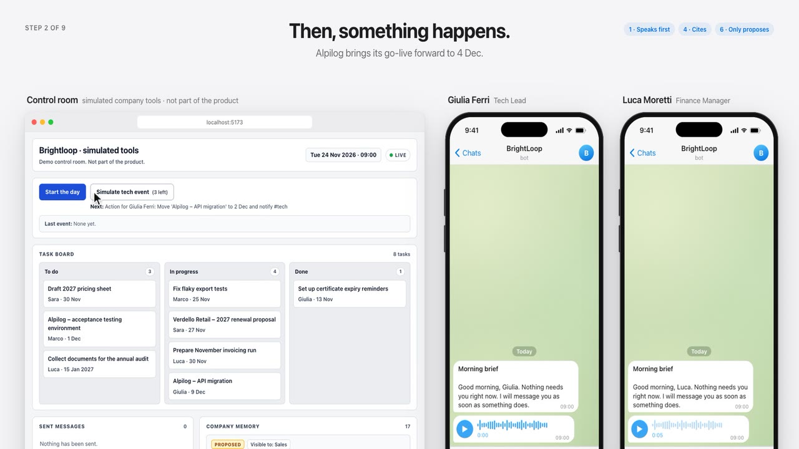

<p align="center"></p>

# BrightLoop

**A linter for company decisions.**

BrightLoop is a prototype built in one day for the "Agentic AI for business" track of a
hackathon. It watches a team's work (emails, chat threads, tasks, docs, pull requests), keeps a
shared memory that team leads approve or reject, and tells each person what needs their
attention before they ask. It lives where the team already is: a real **Telegram bot**.

What sets it apart is that **the memory is active**. Approved decisions are not only used to
answer questions: new work is checked against them. When a lead approves "PostgreSQL over
MongoDB" and a pull request that adds MongoDB shows up later, the Brain alerts the lead on its own,
cites both sources and proposes a note to the author. Nothing happens until a person approves it.

> All data is fictional. The story follows **Brightloop**, an invented software house in Turin,
> and its client **Alpilog**. Nothing is fetched from Gmail, Slack, Drive, GitHub or Jira: those
> names are labels only. The only real channel is Telegram.

---

## Demo video

[](demo-video/brightloop-demo.mp4)

**[▶ Watch the demo (2:54)](demo-video/brightloop-demo.mp4)**

The video runs the 9-step script of [`demo-video/demo.md`](demo-video/demo.md) on the real
backend, with real Gemini and ElevenLabs calls. Telegram is shown on two simulated phones (Giulia
and Luca) next to the control room; they show exactly what the bot would send. Waits for the
model are shortened. The spoken pitch is in [`demo-video/pitch.md`](demo-video/pitch.md).

---

## What it does

The prototype is built to pass seven yes/no checks:

| # | Check | How the Brain meets it |
|---|---|---|
| 1 | **It speaks first** | Sends a morning brief (text + voice) and alerts without being asked. |
| 2 | **People curate the memory** | Proposed facts reach the team lead with Approve / Reject buttons. Only approved facts are used. |
| 3 | **It knows who's asking** | Every source has a visibility; the same question gets different answers for Tech and Finance. |
| 4 | **It cites** | Every answer and alert carries numbered footnotes pointing to the sources. |
| 5 | **It admits gaps** | When the approved, visible memory doesn't hold the answer: *"I don't know. I can't find this in the memory you have access to."* |
| 6 | **It only proposes** | Actions (move a task, send a message) run only when the person taps Approve. |
| 7 | **It fits the team's day** | Everything happens in a Telegram chat; no new app to open. |

These guarantees are **enforced in code, not in the prompt**: visibility is filtered before the
model is called, citations are checked against the items that were given to the model, and
action effects run only inside the approve endpoint.

## How it is built

| Piece | Folder | Stack | Role |
|---|---|---|---|
| **Backend** | `backend/` | Python 3.12, FastAPI, Gemini, ElevenLabs | The Brain: access rules, memory, watcher, brief, actions. |
| **Bot** | `bot/` | Python 3.12, `httpx` | Thin Telegram adapter over the backend API. |
| **Control room** | `frontend/` | Vite, React 19, TypeScript | Read-only page shown next to Telegram during the demo. |
| **Seed data** | `backend/data/seed/` | JSON | 4 people, 45 sources, 17 memory items, 4 actions, 1 incoming pull request. |

No database, no login: the seed is loaded at startup, the live state is kept in memory, and
identity is the `X-User-Id` header. See [Architecture](docs/architecture.md).

## Quick start

Requirements: Python 3.12 with [`uv`](https://docs.astral.sh/uv/), Node.js 18+, a Gemini API key,
a Telegram bot token and two Telegram accounts (ElevenLabs is optional).

```bash
cp .env.example .env
```

Fill in `.env`, then start the three programs, one terminal each:

```bash
cd backend && uv run uvicorn main:app --port 8000
```

```bash
cd bot && uv run python main.py
```

```bash
cd frontend && npm install && npm run dev
```

In each Telegram account send `/start` to the bot and pick **Giulia** in one and **Luca** in the
other. Open the control room at <http://localhost:5173>, press **Start the day** and follow
[`demo-video/demo.md`](demo-video/demo.md).

Tests, offline:

```bash
cd backend && uv run pytest -q
```

Configuration, mock mode and recording the video are in [Development](docs/development.md).

## Documentation

| Page | Contents |
|---|---|
| [Architecture](docs/architecture.md) | The programs, data flow, state, design principles, key decisions. |
| [Backend](docs/backend.md) | Access rules, answers, brief, watcher, actions, model and voice. |
| [API reference](docs/api.md) | Endpoints, shapes, errors, examples. |
| [Data model and seed](docs/data.md) | People, sources, memory, actions, the demo items. |
| [Telegram bot](docs/bot.md) | Chats, delivery, buttons. |
| [Control room](docs/control-room.md) | The demo web page. |
| [Development](docs/development.md) | Setup, configuration, tests, demo video, repository layout. |
| [Development plans](docs/plans/README.md) | Specification, handover, task lists and agent logs from the hackathon. |
